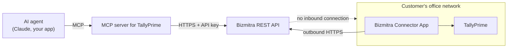

# Build an MCP Server for TallyPrime using the Bizmitra REST API

This guide builds a **Model Context Protocol (MCP) server for TallyPrime**, so an AI agent — Claude, or anything else that speaks MCP — can answer questions about a customer's books and, when you allow it, write vouchers back.

**Bizmitra provides the REST and JSON API layer that an MCP server can use to read from and write to TallyPrime through the Bizmitra Connector App.**

The agent never touches Tally. It calls your MCP server, your MCP server calls the Bizmitra REST API, and the [Bizmitra Connector App](/developer/tally/connector-app) does the work inside the customer's network.

::: tip Clone and run it
Everything on this page exists as a working server in the examples repository: **[`mcp-server/`](https://github.com/BizmitraERP/bizmitra-tally-api-examples/tree/master/mcp-server)**. `npm install`, fill in `.env`, then `npm run smoke` to confirm the handshake before you wire it into an agent.
:::

## Can an AI assistant access TallyPrime through an MCP server?

Yes. The MCP server acts as an adapter between the AI client and the Bizmitra REST API. Bizmitra handles authentication, company pairing, normalized accounting data and communication with the Windows Connector App. The Connector App communicates with TallyPrime locally, so Tally does not need to expose a public internet endpoint.

## Using the Bizmitra REST API as the Tally integration layer

Worth being blunt about, because it is the thing most people discover the hard way:

**TallyPrime does not provide a REST API.** It exposes an XML request/response gateway, served by the Tally process itself on a LAN address — typically `localhost:9000` — and driven by TDL. There is no HTTP+JSON surface, no OAuth, and no public endpoint. It is not the cloud-ready REST/JSON interface a hosted AI system needs, and no amount of prompt engineering changes that.

Three consequences follow, and they are what a TallyPrime integration has to solve:

| Fact about TallyPrime | What it means for an AI agent |
|---|---|
| The gateway is LAN-only | Nothing outside the office network can call it. Port-forwarding Tally to the internet is not an option you should offer a customer |
| It speaks XML/TDL, not JSON | Every request and response needs translating, per voucher type, per report |
| It is single-threaded | Tally serves its gateway on the thread that draws its window. While it answers one request it answers nothing else — see [Sync settings](/tally-connector/sync-settings) |

The **Bizmitra REST API** is the integration layer that resolves all three: an authenticated HTTPS API with normalized JSON over `/api/v1` (see the [API overview](/developer/api/) and [reference](/developer/api/reference)), and a Bizmitra Connector App that reaches *out* from the customer's network so nothing has to be opened up. That is what makes TallyPrime something an MCP server can be built on.

## The shape of it



Four components, and it is worth naming them precisely, because they are parts of one path rather than alternatives to each other:

| Component | What it is | Who runs it |
|---|---|---|
| **MCP server for TallyPrime** | The adapter in this guide. Holds the API key, defines the tools, chooses the company | You |
| **Bizmitra REST API** | The authenticated HTTPS/JSON layer at `/api/v1` that authorizes work and routes it | Bizmitra |
| **Bizmitra Connector App** | The Windows application that collects authorized work and talks to Tally over the local network | Your customer, on their machine |
| **TallyPrime** | The system of record | Your customer |

Your MCP server is an ordinary REST API client. It holds the API key, decides which operations exist, and is the only place that gets to choose which company they run against. The agent gets tools, not credentials.

## What you need

- An application-scoped API key — `key_id` and `secret`. See [Authentication](/developer/api/authentication).
- A paired company, verified with [company health](/developer/tally/company-health).
- A **Tally test company**. Writes are real and Tally has no undo.
- Node.js 18+ for the example below.

## Decide the tool surface first

The temptation is to wrap each endpoint in a tool and let the agent figure it out. Resist it. A tool surface is a product decision: it defines what the agent is able to do, and every tool you add is a thing you are promising to be correct about.

Three rules carry most of the weight.

**One tool per question, not one tool per endpoint.** "What does this customer owe us?" is a question. `GET /api/v1/pulled-vouchers` with six filter parameters is an endpoint. Tools that mirror questions get called correctly; tools that mirror endpoints get called with invented parameters.

**Read tools and write tools are different animals.** Reads are cheap and recoverable. A write puts a voucher in a customer's books permanently. Ship the reads first, and treat each write as its own decision.

**Say when to call it, not just what it does.** A description that states the trigger condition — "Call this when the user asks what a customer owes" — gets used at the right moment. One that only describes the mechanics gets used at the wrong one.

A reasonable starting surface:

| Tool | Backed by | Why it earns a place |
|---|---|---|
| `tally_connection_status` | `GET /companies/{id}/health` | The agent can tell "no data" from "the Tally computer is off" — and say which |
| `tally_list_vouchers` | `GET /pulled-vouchers` | The core read. Filter by kind and date window |
| `tally_get_voucher` | `GET /pulled-vouchers/{transaction_id}` | Full detail including line items and bill references |
| `tally_find_ledger` | `GET /pulled-masters/ledger` | Lets the agent check a party exists — and spelled how — before using the name |
| `tally_stock_summary` | `GET /stock-summary` | Quantities and values without the agent adding up vouchers |
| `tally_create_invoice` | `POST /invoices` | The one write, gated. See [Rules for write tools](#rules-for-write-tools) |

Deliberately **not** on that list: pairing, connector administration, company creation, and the `/api/v1/tally/{resource}` passthrough. They are account-management and escape-hatch operations. An agent has no business holding them, and a prompt injection that reaches them does real damage.

## Scope the server to one company

The single most important line of code in this guide is the one that is missing from the tool schemas: **`company_id` is not a tool parameter.**

If the agent supplies the company, then anything that can influence the agent — a voucher narration, a party name, a pasted email — can aim your API key at a different customer's books. Read it from the server's own configuration instead, and the whole class of attack disappears.

::: danger One server instance, one company
Where you serve many customers, start an MCP server per company with that company's id in its environment, or resolve the id from your own authenticated session — never from the conversation. The agent should not be able to name a company at all.
:::

## The server

Install the MCP server SDK (v2) and Zod:

```bash
npm install @modelcontextprotocol/server zod
```

A thin API helper first. Everything goes through it, so the key and the company live in exactly one place:

```js
// bizmitra.js
const BASE = process.env.BIZMITRA_BASE_URL ?? 'https://bizmitra.io'
const AUTH = `Bearer ${process.env.BIZMITRA_KEY_ID}:${process.env.BIZMITRA_SECRET}`

// Server-side only. Never accepted from a tool argument.
export const COMPANY_ID = process.env.BIZMITRA_COMPANY_ID

export async function get(path, params = {}) {
  const url = new URL(`${BASE}/api/v1/${path}`)
  url.searchParams.set('company_id', COMPANY_ID)
  for (const [k, v] of Object.entries(params)) {
    if (v !== undefined && v !== null) url.searchParams.set(k, String(v))
  }

  const res = await fetch(url, {
    headers: { Authorization: AUTH, Accept: 'application/json' },
  })
  if (!res.ok) throw new Error(`Bizmitra ${res.status}: ${await res.text()}`)
  return res.json()
}

export async function post(path, body) {
  const res = await fetch(`${BASE}/api/v1/${path}`, {
    method: 'POST',
    headers: {
      Authorization: AUTH,
      'X-Bizmitra-Company': COMPANY_ID,   // writes identify the company by header
      Accept: 'application/json',
      'Content-Type': 'application/json',
    },
    body: JSON.stringify(body),
  })
  if (!res.ok) throw new Error(`Bizmitra ${res.status}: ${await res.text()}`)
  return res.json()
}
```

Note the two different conventions: reads take `company_id` as a query parameter, writes carry `X-Bizmitra-Company` as a header. That is the API's own split, documented in [Authentication](/developer/api/authentication#identifying-the-company).

Now the server itself:

```js
// server.js
import { McpServer } from '@modelcontextprotocol/server'
import { StdioServerTransport } from '@modelcontextprotocol/server/stdio'
import * as z from 'zod/v4'
import { get } from './bizmitra.js'

const server = new McpServer({ name: 'tally-bizmitra', version: '0.1.0' })

const ok = (data) => ({ content: [{ type: 'text', text: JSON.stringify(data) }] })

server.registerTool(
  'tally_connection_status',
  {
    description:
      'Check whether this company can be read from or written to right now. ' +
      'Call this first when any other Tally tool returns no data, and before ' +
      'attempting a write. Reports three separate things: whether the company is ' +
      'paired, whether the Connector App is online, and whether TallyPrime is ' +
      'running with the company open.',
    inputSchema: z.object({}),
  },
  async () => ok(await get(`companies/${process.env.BIZMITRA_COMPANY_ID}/health`)),
)

server.registerTool(
  'tally_list_vouchers',
  {
    description:
      'List vouchers that exist in the customer\'s Tally company. Call this when ' +
      'the user asks about sales, purchases, receipts or payments over a period. ' +
      'Returns summary rows only — use tally_get_voucher for line items and bill ' +
      'references. Results are paginated: check `total` against what you received.',
    inputSchema: z.object({
      voucher_kind: z
        .enum(['sales', 'purchase', 'receipt', 'payment', 'credit_note', 'debit_note'])
        .optional()
        .describe('Normalized kind. Prefer this over a Tally voucher-type name, which varies per company.'),
      start_date: z.string().optional().describe('Inclusive, YYYY-MM-DD'),
      end_date: z.string().optional().describe('Inclusive, YYYY-MM-DD'),
      limit: z.number().int().min(1).max(100).default(25),
    }),
  },
  async (args) => {
    const data = await get('pulled-vouchers', args)
    // Return only what the model needs to answer or to drill in. The full rows
    // carry Tally GUIDs and alter-ids that cost tokens and mean nothing to it.
    return ok({
      total: data.total,
      returned: data.count,
      vouchers: (data.invoices ?? []).map((v) => ({
        transaction_id: v.transaction_id,
        date: v.voucher_date,
        kind: v.voucher_kind,
        type: v.voucher_type,
        number: v.voucher_number,
      })),
    })
  },
)

server.registerTool(
  'tally_get_voucher',
  {
    description:
      'Fetch one voucher in full, including line items, tax detail and the bills ' +
      'it opened or settled. Takes a transaction_id from tally_list_vouchers.',
    inputSchema: z.object({
      transaction_id: z.string().describe('From tally_list_vouchers'),
    }),
  },
  async ({ transaction_id }) => ok(await get(`pulled-vouchers/${transaction_id}`)),
)

server.registerTool(
  'tally_find_ledger',
  {
    description:
      'Look up ledgers (parties, tax ledgers, bank and cash accounts) as they are ' +
      'actually named in the customer\'s Tally. Call this before using any ledger ' +
      'name in another tool — Tally matches names exactly, and the customer\'s ' +
      'spelling is rarely the one the user typed. Also reports is_billwise, which ' +
      'says whether this ledger keeps bill-by-bill balances.',
    inputSchema: z.object({
      contains: z.string().optional().describe('Case-insensitive substring to match on the ledger name'),
    }),
  },
  async ({ contains }) => {
    const data = await get('pulled-masters/ledger', { limit: 200 })
    const rows = (data.masters ?? [])
      .map((m) => ({
        name: m.master_name,
        parent: m.payload?.fields?.parent,
        is_billwise: m.payload?.fields?.is_billwise,
      }))
      .filter((m) => !contains || m.name?.toLowerCase().includes(contains.toLowerCase()))
    return ok({ count: rows.length, ledgers: rows.slice(0, 50) })
  },
)

server.registerTool(
  'tally_stock_summary',
  {
    description:
      'Current stock position — quantity, rate and value per item — straight from ' +
      'Tally. Call this for "how much stock do we have" questions instead of ' +
      'adding up vouchers.',
    inputSchema: z.object({}),
  },
  async () => ok(await get('stock-summary')),
)

await server.connect(new StdioServerTransport())
```

Three things that example is doing deliberately, each worth copying:

**It narrows what it returns.** `tally_list_vouchers` drops the Tally GUIDs and alter-ids. They are essential for your own reconciliation and meaningless to a model, and a 50-row page of them is a lot of tokens spent on nothing.

**It tells the agent to resolve names.** `tally_find_ledger` exists because a model asked to record something against "Sharma Traders" will happily use that string when the ledger is actually `Sharma Traders & Co.`. Tally matches exactly, including trailing spaces and capitalisation — see [Masters](/developer/tally/masters#naming).

**It surfaces health as a tool, not an error.** When the Tally computer is off, the honest answer is "the connection is down", not an empty list. Giving the agent a way to find that out is what lets it say so.

## Connect it to an agent

### Local — Claude Code, Claude Desktop

The server above speaks over **stdio**, which is the right transport when the server runs on the same machine as the agent. Register it by command:

```json
{
  "mcpServers": {
    "tally": {
      "command": "node",
      "args": ["/absolute/path/to/server.js"],
      "env": {
        "BIZMITRA_KEY_ID": "...",
        "BIZMITRA_SECRET": "...",
        "BIZMITRA_COMPANY_ID": "123"
      }
    }
  }
}
```

### Remote — the Claude API MCP connector

To let a hosted agent reach the server, run it over **Streamable HTTP** instead and give it a URL. The transport is the only thing that changes; the tools are identical. The SDK exports `WebStandardStreamableHTTPServerTransport` and `createMcpHandler` for this — see the [MCP TypeScript SDK docs](https://ts.sdk.modelcontextprotocol.io/) for the wiring.

::: info This section shows the connection pattern, not a deployment
This section shows the Claude API connection pattern. The repository currently provides the runnable stdio server. To use it remotely, adapt the same tools to Streamable HTTP and deploy the server behind your own authentication.
:::

Claude can then connect to it server-side, with no MCP client of your own:

```python
client.beta.messages.create(
    model="claude-opus-5",
    max_tokens=1024,
    betas=["mcp-client-2025-11-20"],
    mcp_servers=[{"type": "url", "url": "https://tally-mcp.example.com/mcp", "name": "tally"}],
    tools=[{"type": "mcp_toolset", "mcp_server_name": "tally"}],
    messages=[{"role": "user", "content": "What did we invoice last month?"}],
)
```

Both halves are required: a server in `mcp_servers` and a matching `mcp_toolset` entry naming it. Sending the server without the toolset is rejected.

::: warning A remote MCP server is a public door to the customer's books
Put it behind authentication of your own, scope each deployment to one company, and never let the API key reach the agent side of the boundary.
:::

## Rules for write tools

Everything above is read-only and safe to be wrong about. A write is neither. Five rules, each of which exists because of a specific way this goes wrong:

**Gate it on health.** Check [company health](/developer/tally/company-health) before submitting. Without it, a write against an offline Connector fails in a way that looks like a bad payload, and the agent will "fix" the payload repeatedly.

**Own idempotency yourself.** Generate the `transaction_id` in your server code, once, and persist it before you submit. A retrying agent that re-calls a tool must land on the same transaction, not a second voucher. Never let the model supply it.

**Resolve every master first.** A voucher naming a ledger or stock item that does not exist is refused by Tally. Have the agent call `tally_find_ledger` and use the returned name verbatim — and do not create masters from an agent tool. A stray `Sharma Traders (2)` in a customer's chart of accounts is a permanent, visible mess.

**Do not let the agent acknowledge.** `POST /pulled-vouchers/ack` tells Bizmitra you have durably stored a voucher. That is a claim about your database, not about a conversation, and an agent is in no position to make it. Keep acknowledgement in your own pipeline — see [Pull vouchers](/developer/examples/pull-vouchers#_4-acknowledge).

**Require human confirmation.** For anything that lands in real books, show the user what will be written and get an explicit yes. In MCP terms that is your client's approval flow; in product terms it is the difference between a useful assistant and an incident.

And verify after the fact. An accepted write is not a completed write — poll the transaction and persist the `tally_voucher_guid`. The full pattern is in [Create an invoice in Tally](/developer/examples/push-invoice).

## Pace it — Tally answers one request at a time

Agents parallelise by instinct, and this is the one place that is actively harmful. Tally serves its gateway on the same thread that draws its window: while it is answering, it answers nothing else, and a heavy report can hold it for tens of seconds.

Practical consequences for an MCP server:

- **Serialize your own calls.** Do not fan out five report tools concurrently because the model asked for five things.
- **Prefer narrow tools over "fetch everything".** A date-bounded voucher list costs the customer's Tally far less than a full-book scan.
- **Cache what does not move.** Ledger and stock-item lists change rarely; re-reading them on every turn is pure waste.
- **Expect latency.** Reports that the Bizmitra Connector App pulls on a schedule are read from Bizmitra and are fast. A refresh-then-read report is asynchronous by nature.

A customer whose Tally stutters whenever someone uses your AI feature will switch the feature off.

## Current scope

The example repository provides a runnable MCP server with read tools and a gated invoice-write tool. Developers are responsible for deploying and securing their MCP server and for implementing their own user authorization flow.

This page is a technical integration guide with a reference implementation, not a managed product. What Bizmitra operates is the REST API and the Connector App; the MCP server is yours to run.

## When it does not work

| Symptom | Likely cause |
|---|---|
| Agent sees no tools | Server failed to start. A stdio server with a startup exception simply exits, and "no tools" is the only symptom the agent reports. Run it directly, or use the [smoke test](https://github.com/BizmitraERP/bizmitra-tally-api-examples/tree/master/mcp-server#run-it) from the examples repo, which completes a handshake and prints the tool list |
| `401` from every call | Whitespace in the key. A trailing newline from a copied secret is the usual culprit |
| `403` on a company endpoint | The key is valid but that company is not reachable from its application — check the chain in [Authentication](/developer/api/authentication#authorization-is-relational) |
| Tools work, but every list is empty | The Connector is offline or the company is closed in Tally. This is exactly what `tally_connection_status` is for |
| Writes refused, payload looks right | A named ledger or stock item does not exist in that company, or does not match exactly |
| Tally freezes while the agent works | Too many concurrent or too-broad calls. See the pacing section above |

## Frequently asked questions

### Does TallyPrime have a REST API?

No. TallyPrime exposes an XML request/response gateway on a local network address, driven by TDL — not an HTTP+JSON REST API, and not something reachable from outside the office network. The Bizmitra REST API provides the REST/JSON layer, and the Bizmitra Connector App bridges it to Tally locally.

### How can an AI assistant read Tally data?

Through an MCP server that calls the Bizmitra REST API. The assistant calls MCP tools; the MCP server calls `/api/v1` with your API key; the Connector App reads from TallyPrime on the customer's machine. The assistant never holds credentials and never connects to Tally.

### Can an MCP server write invoices to TallyPrime?

Yes — `POST /api/v1/invoices`, along with the other voucher kinds. Writes are irreversible in Tally, so treat them as a separate decision from reads: gate on [company health](/developer/tally/company-health), own idempotency in your own code, resolve every master name first, and require explicit human confirmation. See [Rules for write tools](#rules-for-write-tools).

### What does the Bizmitra Connector App do?

It runs on a Windows computer that can reach TallyPrime, maintains an outbound connection to Bizmitra, collects the work it is authorized to perform, executes that work against Tally over the local network, and reports results back. It holds no business logic of yours. See [The Connector App](/developer/tally/connector-app).

### Does Tally need to be exposed to the internet?

No. The Connector App makes outbound HTTPS connections only — no port forwarding, no static IP, no inbound firewall rule. Bizmitra never initiates a connection into the customer's network.

### Can the MCP server support multiple companies?

Technically yes, but the example deliberately does not. `company_id` comes from the server's environment rather than a tool argument, so one server instance serves one company — see [Scope the server to one company](#scope-the-server-to-one-company). For many customers, run an instance per company, or resolve the company from your own authenticated session. Never from the conversation.

### Is the MCP example read-only?

By default, yes. Five read tools are always registered; the invoice-write tool appears only when `BIZMITRA_ENABLE_WRITES=true`. Read-only is the right default for a first deployment.

### How are duplicate invoices prevented?

The server generates one `transaction_id` per logical invoice, persists it before submitting, and reuses it on retry — so a repeated tool call lands on the same transaction instead of creating a second voucher. The model never supplies the id. After submitting, the server polls the transaction to a final status rather than assuming acceptance meant completion.

## Next

- [`mcp-server/` in the examples repository](https://github.com/BizmitraERP/bizmitra-tally-api-examples/tree/master/mcp-server) — this server, runnable, with a smoke test and the gated write tool
- [API overview](/developer/api/) and [API reference](/developer/api/reference) — the full Bizmitra REST API surface
- [Pull vouchers from Tally](/developer/examples/pull-vouchers) — the read pipeline your `tally_list_vouchers` tool wraps
- [Create an invoice in Tally](/developer/examples/push-invoice) — the full write-and-verify flow
- [Masters](/developer/tally/masters) — why name resolution matters, and `is_billwise`
- [Company health](/developer/tally/company-health) — the gate every write should pass
- [The Connector App](/developer/tally/connector-app) — what is actually executing the work
