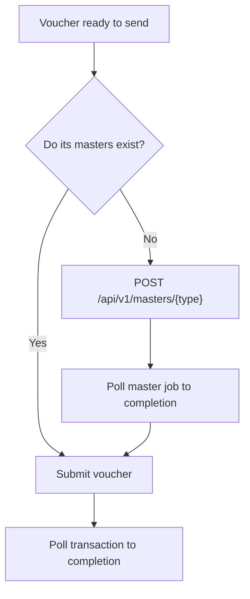

# Masters

**Masters** are the reference data a voucher points at: ledgers, stock items, groups, units, godowns, voucher types. They are created by the customer, in their company, and named however they chose.

## Why they cause most first-integration failures

A voucher payload references masters by name:

```json
{
  "party_ledger": "Example Customer",
  "inventory_entries": [
    { "stock_item": "Example Item", "unit": "Nos", "godown": "Main Location" }
  ],
  "ledger_entries": [
    { "ledger_name": "Sales" }
  ]
}
```

Every one of those strings must match something that exists in the target company, exactly.

The failure is unhelpfully shaped: the request is well-formed, the API accepts it, `success: true` comes back — and the job fails later at the Tally boundary. If you are not checking transaction status, it looks like the write silently vanished.

## Two strategies

**Pre-create masters.** Fine while developing, and fine for a small number of customers you onboard by hand.

**Create them through the API.** Necessary at scale, because you cannot ask 400 customers to create ledgers by hand and get it right.

```http
POST /api/v1/masters/{type}
Authorization: Bearer {key_id}:{secret}
Content-Type: application/json
```

Master creation is asynchronous, like everything else touching Tally:

```http
GET /api/v1/masters/{type}?company_id={company_id}   # list jobs
GET /api/v1/masters/{type}/{job}                     # one job's status
```

## A safe write sequence



Wait for master creation to complete before submitting the voucher that depends on it. Submitting both at once and hoping the ordering works out is a race, and it will resolve differently under load.

## Reading masters back from Tally

`GET /api/v1/masters/{type}` reports **your pushes**. To answer "does this master exist, and how is it configured?" you want the other direction — the masters the Connector has read out of the customer's company:

```http
GET /api/v1/pulled-masters/{type}?company_id={company_id}
Authorization: Bearer {key_id}:{secret}
```

`company_id` is required and is one of your own company `id`s. Page with `limit` (max 200) and `offset`. This endpoint requires the `pull.master` capability on your key and the masters pull enabled for that company; without both, you will see an empty list rather than an error.

Each row carries the master's fields under `payload`:

```json
{
  "success": true,
  "master_type": "voucher_type",
  "total": 24,
  "count": 24,
  "masters": [
    {
      "master_type": "voucher_type",
      "master_name": "Sales Bizmitra",
      "tally_master_guid": "…",
      "request_type": "pull",
      "payload": {
        "kind": "master",
        "master_type": "voucher_type",
        "name": "Sales Bizmitra",
        "fields": {
          "aliases": [],
          "parent": "Sales",
          "reserved_name": "Sales",
          "numbering_method": "Manual",
          "numbering_sub_method": "Auto Renumber",
          "numbering_series": [
            {
              "name": "Default",
              "numbering_method": "Manual",
              "numbering_sub_method": "Auto Renumber",
              "prevent_duplicates": "No",
              "is_default": "No"
            }
          ],
          "is_active": "Yes",
          "affects_stock": "No"
        },
        "tally": { "guid": "…", "master_id": "…", "alter_id": "914" }
      }
    }
  ]
}
```

### What each type exposes

`payload.fields` varies by type. Every type also carries `name`, `aliases` (see [Aliases](#aliases)) and `tally.guid` / `master_id` / `alter_id`.

| Type | Fields |
|---|---|
| `group` | `parent`, `is_subledger`, `is_deemed_positive`, `is_revenue` |
| `ledger` | `parent`, `currency`, `opening_balance`, `gstin`, `gst_registration_type`, `mobile`, `email`, `is_billwise`, `mailing_name`, `address`, `state`, `country`, `pincode` |
| `currency` | `mailing_name`, `original_name`, `expanded_symbol`, `iso_code`, `decimal_places` |
| `unit` | `is_simple_unit`, `decimal_places`, `base_units`, `additional_units` |
| `godown` | `parent` |
| `stock_group` | `parent`, `base_units`, `is_batchwise`, `closing_balance`, `closing_value` |
| `stock_category` | `parent` |
| `stock_item` | `parent`, `category`, `base_units`, `opening_balance`, `closing_balance`, `closing_value`, `gst_applicable` |
| `voucher_type` | `parent`, `reserved_name`, `numbering_method`, `numbering_sub_method`, `numbering_series`, `is_active`, `affects_stock` |

::: warning Values are Tally's, verbatim
Fields are passed through unmodified — no casing, type coercion, or normalization. Booleans arrive as Tally's `"Yes"` / `"No"` strings, not JSON `true` / `false`, and text like `numbering_method` arrives as Tally spells it. Compare case-insensitively rather than against an exact literal.
:::

### Whether a ledger keeps bills

`is_billwise` is Tally's *Maintain balances bill-by-bill* setting on that ledger, as `"Yes"` or `"No"`. It matters more than its size suggests, because it decides whether bill references you send are kept at all.

| `is_billwise` | Sending `bill_allocations` to this ledger |
|---|---|
| `Yes` | The reference is kept. An invoice opens a bill; a receipt or payment can settle against it |
| `No` | Tally accepts the voucher and keeps no bill reference. Nothing errors, and nothing can be matched to it later |

So the useful places to read it are both ends of the integration:

- **At setup**, warn when a party ledger you are about to transact against is not configured bill-by-bill. It is a one-line fix in Tally for the customer, and a permanently unmatchable ledger if nobody notices.
- **Before sending**, send `bill_allocations` only to ledgers that will keep them.

```js
const { masters } = await api.get('/api/v1/pulled-masters/ledger', {
  params: { company_id: companyId },
})

const party = masters.find(m => m.master_name === partyLedger)

// Tally's strings, compared case-insensitively — see the warning above.
if ((party?.payload?.fields?.is_billwise ?? '').toLowerCase() !== 'yes') {
  warn(`${partyLedger} does not keep balances bill-by-bill — bill references sent to it are dropped`)
}
```

Tally omits the underlying tag entirely on some builds and returns `No` on others; Bizmitra normalizes both to a plain `"No"`, so you never have to read a missing value as "off".

Bill references themselves are covered in [Pulling vouchers](/developer/examples/pull-vouchers#which-bills-a-voucher-opened-or-settled) and [Pushing a receipt](/developer/examples/push-receipt).

### The party's postal identity

A ledger also carries the address block Tally holds for that party:

| Field | Meaning |
|---|---|
| `mailing_name` | The name to address the party by, which is often not the ledger name |
| `address` | The address, as an **array of lines**, blanks removed |
| `state` | Tally's state for the ledger — what decides GST place of supply |
| `country` | Country name |
| `pincode` | Postal code |

```json
{
  "name": "Example Party Ltd",
  "fields": {
    "mailing_name": "Example Party Limited",
    "address": ["201, Second Floor", "Example Complex", "Ahmedabad"],
    "state": "Gujarat",
    "country": "India",
    "pincode": "380015",
    "gstin": "24AAAAA0000A1Z5",
    "gst_registration_type": "Regular"
  }
}
```

`address` is a list, not a string: Tally stores an address as separate lines and
there is no single-line form that is correct for every party. Join it yourself
with whatever separator your document needs. A ledger with no address gives an
empty list, never `null`.

`state` is the field to read for an intra- vs inter-state GST decision. Pair it
with `gstin` and `gst_registration_type` and you can work out the party's tax
position from the pulled ledger alone, without asking the customer.

::: tip If these five are missing
They are confirmed working on current TallyPrime, but they are read with field
names an older build may not answer. Where one refuses them, the Connector
re-reads the ledger without them rather than failing the whole ledger pull — so
the five are absent and everything else (including `is_billwise` and `gstin`) is
there as usual. Read them defensively and you are covered either way.
:::

### Whether a voucher type is active

`is_active` is Tally's *activate this voucher type* setting, as `"Yes"` or
`"No"`, passed through exactly as Tally answers it.

**It does not tell you whether you can post to that voucher type.** This is the
important part, and it is not what the name suggests:

| What you might assume | What is actually true |
|---|---|
| `No` means the type is unusable | A voucher **imports successfully** into a type reading `No` |
| `No` means somebody de-activated it | It is usually the **factory default** — TallyPrime ships its secondary voucher types deactivated |

It is the *Activate this Voucher Type* field on Tally's voucher-type screen,
and TallyPrime ships Memorandum, Delivery Note, Receipt Note, Reversing Journal
and the Job Work orders with it set to `No`. The customer turns on the ones they
want to use. So `No` on those is the ordinary, untouched state and not a sign
that anything is wrong.

Measured on a TallyPrime test company: of 26 voucher types, 5 reported `No` —
exactly that set, none of them edited by anyone. A voucher pushed into
Memorandum was accepted (`CREATED=1`, `ERRORS=0`), and so was one pushed into a
custom type created with the flag explicitly set to `No`.

So treat `is_active` as information about Tally's own voucher-entry menus, not
as a precondition:

```js
// Wrong — this discards voucher types that work.
const usable = types.filter(t => t.payload.fields.is_active === 'Yes')
```

If you want to know whether a voucher type will accept your push, the field that
actually matters is `numbering_method` (below), plus the type existing at all.

::: warning If a voucher type you use reports "No"
That is Tally's answer, not a Bizmitra bug, and it does not need fixing before
you can post. It is worth surfacing to the customer only as a note — the type is
not reachable from Tally's own voucher-entry screens, so they cannot see or key
those vouchers themselves, which they may not have intended. The fix is theirs:
set *Activate this Voucher Type* to Yes on the voucher type.
:::

### Verifying customer setup

This is the endpoint to build an admin or preflight screen on, instead of relying on someone remembering what they configured during onboarding.

The common check is voucher-type numbering. If your integration posts vouchers with numbers you generate, you need to know whether Tally will keep your number or assign its own. `numbering_method` is one of Tally's five settings:

| `numbering_method` | Your `voucher_number` |
|---|---|
| `Manual` | kept |
| `Automatic (Manual Override)` | kept — this is Tally's default on a new voucher type |
| `Automatic` | **discarded**; Tally assigns its own |
| `Multi-user Auto` | **discarded**; Tally assigns its own |
| `None` | the voucher carries no number at all |

```js
const { masters } = await api.get('/api/v1/pulled-masters/voucher_type', {
  params: { company_id: companyId },
})

// Allowlist what keeps your number, so an unrecognised value warns rather than
// passing silently — a missed warning means a wrong number on a real invoice.
const KEEPS_YOUR_NUMBER = ['manual', 'automatic (manual override)']

const type = masters.find(m => m.master_name === postingVoucherType)
const method = (type?.payload?.fields?.numbering_method ?? '').toLowerCase()

if (!KEEPS_YOUR_NUMBER.includes(method)) {
  warn(`${postingVoucherType} is set to "${method}" — Tally will assign its own number`)
}
```

::: tip Where this value comes from
TallyPrime keeps a voucher type's numbering on its **numbering series**, not on the voucher type itself. The voucher type carries a field of the same name, but Tally stamps it once at creation and never updates it — so it commonly reads `Automatic (Manual Override)`, or `None` on types Tally derives itself, no matter what the voucher-type screen shows. `numbering_method` here is read from the series, so it matches the screen.

`numbering_sub_method` is the "numbering behaviour on insertion/deletion" setting: `Auto Renumber` (Renumber Vouchers), `Auto Retain` (Retain Original Voucher No.), or `Default` when it was never changed.

A voucher type can run **several numbering series**, in which case no single value describes it — `numbering_method` reflects the default series, and `numbering_series` lists them all.
:::

Two fields make this check more robust than name matching alone:

**`reserved_name`** identifies which built-in type a custom or renamed type derives from. Tally sets it only on its own types (`Sales`, `Purchase`, `Receipt`, …) and keeps it through a rename, so a type the customer renamed `Branch Billing` still reports `reserved_name: "Sales"`. Classify on this, not on the display name.

**`tally.alter_id`** increments whenever the master is altered in Tally. Store it at setup and compare on later reads to flag "someone changed this since we verified it" — rather than only ever seeing current state.

Pair your own records on `tally_master_guid`, as with pushes: it survives renames and re-imports, where the numeric `master_id` is per-company and the name can change.

::: info Freshness
Pulled masters refresh on the Connector's normal sync cycle, not on demand. A master created in Tally seconds ago may not be in this list yet, so treat a miss as "not seen yet" rather than "does not exist" when you are racing a customer's data entry.
:::

## Naming

Master names are the customer's data. Bizmitra does not normalize, trim, or case-fold them, and should not — quietly matching `example customer` to `Example Customer` would eventually post a transaction into the wrong ledger.

Practical consequences:

- Normalize on **your** side before sending, and be consistent about it.
- Watch for trailing whitespace. It is invisible, survives copy-paste, and is a real cause of mismatches.
- Store the resolved master name against your own record once it works, rather than reconstructing it each time.

### Aliases

A Tally master can answer to more than one name. The customer sets an alias so they can type `EC` instead of `Example Customer` during voucher entry, and it is genuinely how many of them work day to day — which means the name your user gives you is quite often an alias, not the master name.

`aliases` comes back on every pulled master:

```json
{
  "master_type": "ledger",
  "master_name": "Example Customer",
  "payload": {
    "kind": "master",
    "master_type": "ledger",
    "name": "Example Customer",
    "fields": {
      "aliases": ["EC", "EXC"],
      "parent": "Sundry Debtors",
      "gstin": "24AAAAA0000A1Z5"
    },
    "tally": { "guid": "…", "master_id": "…", "alter_id": "917" }
  }
}
```

**It is a list, and a master can hold several.** The ledger above answers to `Example Customer`, `EC` and `EXC`, and all three work in Tally's voucher entry. Code that reads `aliases[0]` and stops will match one customer's shorthand and miss another's.

**Every master type carries it**, and it is `[]` — never `null` and never absent — when the master has no alias. Tally's own built-in groups ship with aliases already set (`Indirect Expenses` also answers to `Expenses (Indirect)`), so you will see populated lists in a company nobody has customized.

The practical use is **resolution, not sending**: match what your user typed against `name` *and* `aliases`, then send the `name`. Store the resolved `name` against your record, as with any other master — it is the value the rest of the API reports and the one your mapping should hold.

```js
// Resolve a user-supplied name to the master it means.
const { masters } = await api.get('/api/v1/pulled-masters/ledger', {
  params: { company_id: companyId },
})

const wanted = input.trim().toLowerCase()
const match = masters.find(m => {
  const fields = m.payload?.fields ?? {}
  return [m.payload?.name, ...(fields.aliases ?? [])]
    .some(n => n?.trim().toLowerCase() === wanted)
})

// Send the master's own name, not what the user typed.
const partyLedger = match?.payload?.name
```

::: info Requires connector v0.0.44
Older connectors return no `aliases` key at all. Read it defensively (`fields.aliases ?? []`) so a company on an older build degrades to name-only matching rather than throwing.
:::

::: tip Aliases change without the name changing
Adding an alias is an alter, so `tally.alter_id` moves and the master re-syncs — but `name` is unchanged, and a check that compares only names will report "nothing changed". If you cache a resolution table, rebuild it on `alter_id`, not on the name.
:::

## How fresh pulled masters are

Pulled masters are a cache the Connector refreshes on a schedule. It is not
live: a ledger created in Tally a minute ago may not be in the feed yet.

Two passes keep it current, and they answer different questions:

| Pass | What it reads | When |
|---|---|---|
| **Changed masters** | Only masters whose Tally `alter_id` moved since the last pass | Every sync cycle off-hours; at most every 15 minutes during the customer's business hours |
| **Full re-read** | Every master of every type, regardless of `alter_id` | Every 30 minutes off-hours; at most hourly during business hours |

The full re-read is the one that matters for anything other than day-to-day
edits. A changed-masters pass can only ever bring you masters somebody edited —
so when Bizmitra adds a **new field** to the pull, that field reaches an
already-linked company's untouched masters on the next full re-read, not before.

You do not have to ask for one. The Connector fingerprints the set of fields it
pulls, and an upgrade that changes that set makes every linked company owe
exactly one full re-read, which it performs on its next cycle. That is how a new
field — or a correction to how an existing one is read, like `is_active` above —
reaches a company that has been linked for months.

::: warning Masters stopped refreshing on v0.0.51 and earlier
On those builds the whole masters pull counted as heavy work, which Business
Hours mode (the default) defers to off-hours. On a customer PC that is switched
off in the evening, off-hours never arrive — so masters stopped refreshing
entirely and the Connector reported every attempt as *deferred*, indefinitely,
while vouchers kept syncing normally.

If a customer's pulled masters are stale and the dates stop moving, that is the
cause, and v0.0.52 is the fix: both passes now run during business hours on the
slower cadences in the table above.
:::

## Do not create masters casually

Every ledger and stock item you create appears in the customer's books, in their reports, and in front of their accountant. A stray `Customer Name (2)` from a retry is a real annoyance for them.

- Check before creating — see [Reading masters back from Tally](#reading-masters-back-from-tally).
- Make creation idempotent on your side.
- Do not auto-create from unvalidated user input. A typo in your product becomes a permanent ledger in their accounts.

## Group and hierarchy data

Stock groups can be read as a tree:

```http
GET /api/v1/stock-tree
```

Useful for showing the customer their own catalogue structure when mapping your product's items to theirs — which is generally a better onboarding experience than asking them to type names that must match exactly.
